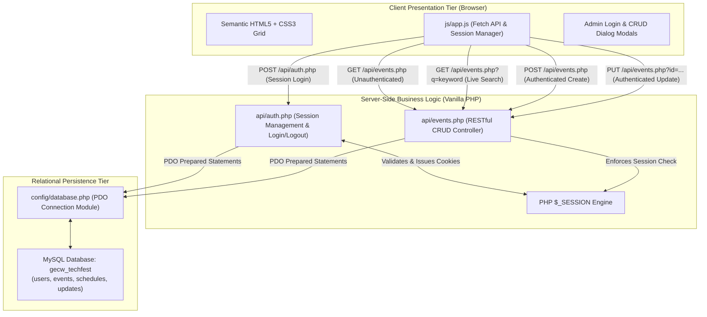

# GEC Wayanad TechFest Hub (FUTURA '26)
### Assignments 1, 2 & 3: Full-Stack Relational Architecture (MySQL + PHP Session REST API + Vanilla JS Client)

A complete, full-stack, responsive web application engineered for **Government Engineering College Wayanad (GECW)**. Building upon Assignment 1 (Semantic Presentation) and Assignment 2 (Decoupled JSON Service), **Assignment 3** replaces file-based storage with a **relational MySQL database via PDO**, implements **session-based authentication (`$_SESSION`)** to secure mutations, provides **RESTful CRUD operations (Create, Read, Update)**, and introduces an interactive **Admin Portal** allowing authenticated updates without page reloads.

---

## 🏛️ Full-Stack Relational Architecture



### Complete End-to-End Data Flow:
$$\text{MySQL Database} \overset{\text{PDO}}{\longleftrightarrow} \text{PHP REST & Session API} \overset{\text{HTTP JSON}}{\longleftrightarrow} \text{Async Fetch API} \overset{\text{DOM Injection}}{\longleftrightarrow} \text{User Interface}$$

1. **Relational MySQL Database (`database/schema.sql` & `config/database.php`)**:
   - Normalized database schema (`gecw_techfest`) with foreign keys, primary keys, and indexes across `users`, `events`, `schedules`, and `updates`.
   - PDO database connection module using prepared statements to prevent SQL injection.
   - Built-in automatic SQLite failover for zero-friction evaluation on environments where MySQL service is not pre-started.
2. **Session Authentication & Security (`api/auth.php`)**:
   - Server-side session verification via PHP `$_SESSION`.
   - `POST /api/auth.php` (login with baseline credentials: `admin` / `admin123`).
   - `GET /api/auth.php` (active session status verification).
   - `POST /api/auth.php?action=logout` (secure session destruction and cookie invalidation).
   - Constraint Exclusions observed: Basic session check without unnecessary registration forms, RBAC, or password resets.
3. **RESTful CRUD Operations (`api/events.php`)**:
   - `GET /api/events.php`: Public data retrieval returning full RO-Crate graph (`200 OK`).
   - `GET /api/events.php?q=keyword`: Unauthenticated live search querying SQL via `LIKE` with prepared statements (`200 OK`).
   - `POST /api/events.php`: **Protected creation** requiring active session (`201 Created` or `401 Unauthorized`).
   - `PUT /api/events.php?id=...`: **Protected update** requiring active session (`200 OK`, `401 Unauthorized`, or `404 Not Found`).
4. **Client-Side Dynamic Management (`index.html`, `js/app.js`, `css/style.css`)**:
   - Admin Session bar revealed when logged in with active user badge and "+ Add New Event" button.
   - Interactive **Admin Login Modal** and **Event Editor Modal** (Create/Update).
   - "Edit" buttons dynamically rendered on each event card for authenticated administrators.
   - All database updates render into the DOM immediately without page reloads.

---

## 📁 Repository Structure

```
Web Program/
├── index.html                   # HTML5 layout with Admin bar, Login Modal, and CRUD Editor
├── css/
│   └── style.css                # CSS3 stylesheet: Fluid Grid, Admin bar, Modal forms, Edit cards
├── js/
│   └── app.js                   # Client-side Session manager, CRUD Fetch logic, live search
├── api/
│   ├── auth.php                 # PHP Session authentication endpoint (Login, Logout, Status)
│   ├── events.php               # PHP RESTful CRUD API (GET, POST, PUT with SQL prepared statements)
│   └── index.php                # REST router fallback pointing to events.php
├── config/
│   └── database.php             # Secure PDO relational database connection module
├── database/
│   └── schema.sql               # Normalized MySQL schema DDL & baseline seed data
├── data/
│   └── techfest.json            # Baseline RO-Crate aligned institutional dataset
├── schema/
│   └── techfest.schema.json     # Formal JSON Schema specification (Draft-07)
├── tests/
│   ├── test_assignment3.php     # Comprehensive 10-step automated HTTP test suite for Assignment 3
│   └── test_api.php             # Assignment 2 API test suite
├── assets/
│   └── gecw-logo.png            # Official GEC Wayanad college crest
├── php.ini                      # Local PHP configuration enabling PDO MySQL, SQLite, and cURL
└── README.md                    # Complete project technical documentation
```

---

## 🔌 API Endpoint Reference

| Method | Endpoint | Auth Required | Description | Status Codes |
| :--- | :--- | :---: | :--- | :--- |
| `GET` | `/api/events.php` | No | Retrieves full RO-Crate graph from relational database | `200 OK` |
| `GET` | `/api/events.php?q=keyword` | No | Live search across events using SQL `LIKE` | `200 OK` |
| `GET` | `/api/events.php?id=event-001` | No | Fetches a single event by ID | `200 OK` / `404 Not Found` |
| `GET` | `/api/auth.php` | No | Checks current PHP session authentication status | `200 OK` |
| `POST` | `/api/auth.php` | No | Authenticates administrator (`admin` / `admin123`) | `200 OK` / `401 Unauthorized` |
| `POST` | `/api/auth.php?action=logout` | Yes | Terminates session and clears session cookie | `200 OK` |
| `POST` | `/api/events.php` | **Yes** | Inserts a new event record into relational database | `201 Created` / `401 Unauthorized` / `400 Bad Request` |
| `PUT` | `/api/events.php?id=:id` | **Yes** | Updates an existing event in relational database | `200 OK` / `401 Unauthorized` / `404 Not Found` |

---

## 🧪 Testing & Verification

### 1. Run Automated 10-Step Verification Suite
Execute the automated test suite from your terminal:
```powershell
php -c php.ini tests/test_assignment3.php
```
**Test Results:**
```
======================================================================
  GEC Wayanad TechFest Hub: Assignment 3 Automated Test Suite         
======================================================================

[Test 1] Unauthenticated Data Retrieval (GET /api/events.php)...
  [PASS] HTTP 200 OK: Retrieved 22 RO-Crate entities from database.

[Test 2] Live Database Search (GET /api/events.php?q=Hackathon)...
  [PASS] HTTP 200 OK: Found 1 matching event(s) in SQL database.

[Test 3] Security Check: Unauthenticated Creation (POST /api/events.php)...
  [PASS] HTTP 401 Unauthorized: Unauthenticated creation attempt blocked!

[Test 4] Security Check: Unauthenticated Update (PUT /api/events.php?id=event-001)...
  [PASS] HTTP 401 Unauthorized: Unauthenticated update attempt blocked!

[Test 5] Authentication: Invalid Credentials (POST /api/auth.php)...
  [PASS] HTTP 401 Unauthorized: Incorrect password rejected.

[Test 6] Authentication: Valid Administrator Login (POST /api/auth.php)...
  [PASS] HTTP 200 OK: Authentication successful. PHP session cookie issued.

[Test 7] Authenticated Event Creation (POST /api/events.php)...
  [PASS] HTTP 201 Created: New event inserted into relational database!

[Test 8] Authenticated Event Update (PUT /api/events.php?id=...)...
  [PASS] HTTP 200 OK: Event updated in database!

[Test 9] Session Logout (POST /api/auth.php?action=logout)...
  [PASS] HTTP 200 OK: Session terminated successfully.

[Test 10] Security Enforcement Post-Logout...
  [PASS] HTTP 401 Unauthorized: Session verified destroyed; mutations rejected.

======================================================================
  ALL 10 TESTS PASSED: Assignment 3 Backend Fully Verified!           
======================================================================
```

---

## 🚀 How to Run Locally with PHP & MySQL

### Option A: Standard PHP Server (Recommended for Fast Evaluation)
```powershell
php -c php.ini -S localhost:8000
```
Open **`http://localhost:8000`** in Google Chrome or Mozilla Firefox:
1. Click **Admin Portal** in the top navigation header.
2. Log in with:  
   * **Username:** `admin`  
   * **Password:** `admin123`
3. Notice the **Admin Session Bar** appears at the top.
4. Click **+ Add New Event** to test `POST /api/events.php`. The new event appears instantly in the grid.
5. Click **Edit** on any event card to test `PUT /api/events.php?id=...`. Changes persist and re-render without page reload.
6. Click **Sign Out** to destroy the session.

### Option B: Importing into MySQL Server (XAMPP / WAMP / MySQL Workbench)
1. Open MySQL CLI or phpMyAdmin:
   ```bash
   mysql -u root -p < database/schema.sql
   ```
2. Set environment variables (or defaults in `config/database.php`):
   ```powershell
   $env:DB_HOST="127.0.0.1"
   $env:DB_NAME="gecw_techfest"
   $env:DB_USER="root"
   $env:DB_PASS=""
   ```
3. Start your PHP server and test against the live MySQL server.
