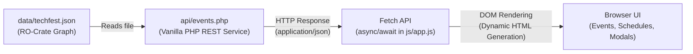

# GEC Wayanad TechFest Hub (FUTURA '26)
### Assignments 1 & 2: Decoupled Data-Driven Web Architecture (PHP RESTful API + Vanilla Client)

A decoupled, responsive, data-driven web portal engineered for **Government Engineering College Wayanad (GECW)**. Building directly upon the Assignment 1 presentation foundation, Assignment 2 introduces a standalone **RO-Crate-aligned JSON schema**, a **vanilla PHP RESTful data service**, and an asynchronous client-side data consumer utilizing the **Fetch API** with full UI feedback for loading and error states.

---

## 🏛️ End-to-End Decoupled Architecture



### Complete End-to-End Data Flow:
$$\text{JSON File} \longrightarrow \text{PHP Server Endpoint} \longrightarrow \text{HTTP JSON Response} \longrightarrow \text{Client Fetch API} \longrightarrow \text{Dynamic DOM Injection}$$

1. **Data Layer (`data/techfest.json` & `schema/techfest.schema.json`)**:
   - Independent dataset structured around the RO-Crate-aligned graph schema (`{ "graph": [ ... ] }`).
   - Formally validated against a Draft-07 JSON Schema covering `Event`, `Competition`, `Workshop`, `Talk`, `Schedule`, and `Update` entities.
2. **Server-Side Data Provider (`api/events.php`)**:
   - Strict vanilla PHP data provider (no external frameworks, databases, or third-party APIs).
   - Enforces `GET` method constraints and sets proper headers (`Content-Type: application/json; charset=UTF-8`, CORS, nosniff).
   - Emits HTTP status codes (`200 OK`, `404 Not Found`, `405 Method Not Allowed`, `500 Server Error`).
   - Supports RESTful query filters: `?type=...`, `?category=...`, `?id=...`, and `?search=...`.
3. **Client-Side Engine (`js/app.js`, `index.html`, `css/style.css`)**:
   - Asynchronously consumes data via the `Fetch API` (`async/await`).
   - **UI Loading Feedback**: Animated loading state (`#fetch-loading-state`) during network transmission.
   - **UI Error Feedback**: Visual error state card (`#fetch-error-state`) with a one-click *"Retry Connection"* button upon network or server failures.
   - Client-side instant zero-reload search and category filtering across all dynamic cards.

---

## 📁 Repository Structure

```
Web Program/
├── index.html                   # Semantic HTML5 layout with loading/error feedback containers
├── css/
│   └── style.css                # External CSS3: Custom properties, Box-Model, Grid, Loading spinners
├── js/
│   └── app.js                   # Client-side Fetch engine, dynamic DOM generation, instant filtering
├── api/
│   ├── events.php               # Server-side Vanilla PHP RESTful data endpoint
│   └── index.php                # REST router fallback pointing to events.php
├── data/
│   └── techfest.json            # Standalone RO-Crate aligned institutional dataset
├── schema/
│   └── techfest.schema.json     # Formal JSON Schema specification (Draft-07)
├── tests/
│   └── test_api.php             # Automated test suite verifying PHP API status codes and queries
├── assets/
│   └── gecw-logo.png            # Official GEC Wayanad college crest
└── README.md                    # Full technical and deployment documentation
```

---

## 🔌 PHP RESTful Endpoint Reference (`api/events.php`)

| Method | Endpoint | Query Parameters | Description | Status Code |
| :--- | :--- | :--- | :--- | :--- |
| `GET` | `/api/events.php` | None | Retrieves the full RO-Crate graph (`21 entities`) | `200 OK` |
| `GET` | `/api/events.php?type=Competition` | `type` | Filters graph entities by type (`Competition`, `Workshop`, `Talk`) | `200 OK` |
| `GET` | `/api/events.php?id=event-001` | `id` | Retrieves a single entity by its unique ID | `200 OK` / `404 Not Found` |
| `GET` | `/api/events.php?search=ai` | `search` | Server-side query search across entity attributes | `200 OK` |
| `POST` | `/api/events.php` | N/A | Unsupported method | `405 Method Not Allowed` |

---

## 🧪 Testing the Application

### 1. Automated PHP API Test Suite
Run the automated test suite from your terminal:
```powershell
php tests/test_api.php
```
**Expected Output:**
```
============================================================
  GEC Wayanad TechFest REST API Test Suite (Assignment 2)   
============================================================

[Test 1] Retrieving Full RO-Crate Graph...
  [PASS] Status: 200 | Total entities: 21

[Test 2] REST Query: ?type=Competition...
  [PASS] Found 4 competitions
...
============================================================
  All 5 RESTful API Tests Passed Successfully!             
============================================================
```

### 2. Local PHP Built-in Server Execution
Start the PHP built-in web server in the project root:
```powershell
php -S localhost:8000
```
Open **Google Chrome** or **Mozilla Firefox** and navigate to:
```
http://localhost:8000
```
- Observe the initial connection feedback: *"Connecting to PHP RESTful Data Service..."*
- Observe dynamic rendering of the Hero, Events, Schedules, and Live Updates.
- Test instant client-side filtering without page reloads.

### 3. Testing Error Handling & Retry Feedback
To test the error handling state:
1. Temporarily rename or stop the PHP server.
2. Click **Retry Connection** in the browser.
3. Observe the `#fetch-error-state` UI alert banner with the error message.
4. Restart the server and click **Retry Connection** to confirm smooth recovery.

---

## 🌐 Deployment Instructions

### Free PHP Web Hosting (InfinityFree, 000webhost, Render, or cPanel Host)
1. Upload the entire project directory (`index.html`, `css/`, `js/`, `api/`, `data/`, `schema/`, `assets/`) to the `public_html` directory of your PHP host.
2. Verify PHP 7.4+ or PHP 8.x is enabled.
3. Access your live domain: `https://your-site.infinityfreeapp.com/`.

### GitHub Pages (Static Hosting Resilience)
The client-side `js/app.js` is built with automatic resilience:
- When running on a PHP server, it communicates with `api/events.php`.
- When deployed on static GitHub Pages (which does not execute PHP scripts), it gracefully falls back to direct `data/techfest.json` asynchronous fetching.
- **GitHub Repository:** [https://github.com/Devajith11/web_program](https://github.com/Devajith11/web_program)
- **Live Deployment:** [https://devajith11.github.io/web_program/](https://devajith11.github.io/web_program/)
